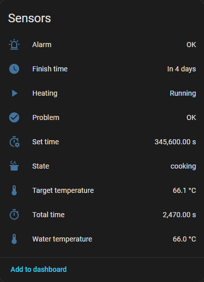
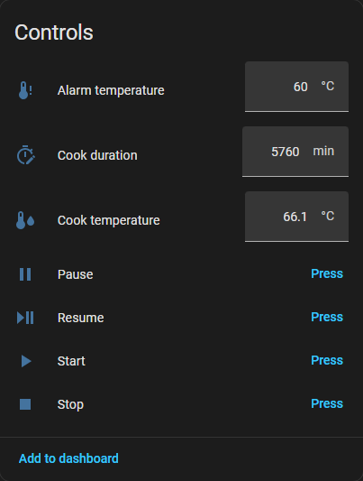

# kitchenboss – unofficial Python tool for KitchenBoss Wi-Fi sous-vide cookers

Reads and controls KitchenBoss Wi-Fi models (tested target: **G322PT**; G320PX / G300PT use the
same app) through the same cloud path the official Android app uses: a REST login to
`simmer.kitchenbossglobal.com` to obtain the per-device AWS IoT certificate, then MQTT over TLS to
AWS IoT Core. There is no LAN protocol; the cooker only speaks to the cloud. See
[PROTOCOL.md](PROTOCOL.md) for the full reverse-engineered protocol.

The included MQTT bridge exposes each cooker in Home Assistant, with alerts for long cooks:

 

## Install

```bash
pip install -r requirements.txt          # requests, paho-mqtt>=2, PyYAML, bleak (BLE optional)
# or
pip install -e .
```

Python 3.10+.

## Quick start

```bash
python -m kitchenboss login you@example.com        # prompts for the app password, caches devices
python -m kitchenboss devices
python -m kitchenboss status
python -m kitchenboss start 56.5 --time 1h30m       # °C by default
python -m kitchenboss start 135 -u F --time 90m
python -m kitchenboss pause
python -m kitchenboss resume
python -m kitchenboss stop
python -m kitchenboss watch                          # live status until Ctrl-C
python -m kitchenboss watch --json --poll 30        # one JSON line per report, extra cook_get every 30 s
python -m kitchenboss config --unit C --silent off --language de
python -m kitchenboss export-certs ./certs          # for mosquitto_sub / Home Assistant / ESP32
```

If `pip install -e .` was used, `kitchenboss ...` works as a command.

Credentials and the device cache live in `~/.kitchenboss/config.json` (override with
`--config` or `KITCHENBOSS_CONFIG`). The file contains the device private key – keep it private.

Several devices: pick with `-d <name|id|mac>` or set a default with `kitchenboss use <name>`.

## Commands

| Command | Does |
|---|---|
| `login [email]` | log in (password hashed with MD5 like the app), cache token + devices |
| `devices [--refresh] [--json --raw]` | list devices; `--raw` dumps the full cloud record incl. certificates |
| `use DEVICE` | set default device |
| `status [--json]` | `cook_get.sub` → current temperature, target, remaining time, state, error |
| `watch [--poll N] [--json] [--all]` | stream `cook_report.pub` messages |
| `start TEMP [-u C\|F] -t DURATION [--recipe N]` | `cook_set.sub` with `work_state=3` |
| `pause` / `resume` / `stop` / `reset` | resend current program with `work_state` 2 / 3 / 4 / 0 |
| `set --state N --temperature T -t DURATION` | raw `cook_set.sub` with every field explicit |
| `send CMD [JSON]` | publish any command on `/mcu/sub` and print the reply |
| `attrs` | `attr_get.sub` (reply format not known, printed raw) |
| `config [--name] [--unit] [--silent] [--language]` | device settings via the cloud REST API |
| `firmware` | firmware version info |
| `export-certs DIR` | write `cert.pem`, `key.pem`, `root-ca.pem`, `mqtt.json` |
| `ble scan` / `ble info ADDR` / `ble wifi-list ADDR` / `ble provision ADDR --ssid --password` | Bluetooth LE setup of a new cooker (needs `bleak`) |

Durations: `1h30m`, `90m`, `5400s`, `2:30` (h:mm) or plain minutes.

`--debug` prints every MQTT payload. `--mimic-app` uses the app's exact MQTT client id
(`android_client_snxtest`); this disconnects the phone app while the tool runs.

## Library use

```python
from kitchenboss import KitchenBossApi, KitchenBossMqtt, TempUnit

api = KitchenBossApi()
api.login("you@example.com", "password")
device = api.devices()[0]

with KitchenBossMqtt(device) as mqtt:
    st = mqtt.get_status()
    print(st.describe())
    mqtt.start(56.5, TempUnit.CELSIUS, 90 * 60)
    mqtt.watch(lambda status, msg: print(status.to_dict()))
```

## MQTT bridge / Home Assistant

`kitchenboss-bridge` keeps a cloud connection to every configured cooker and mirrors it to a local
MQTT broker, with Home Assistant MQTT discovery.

```bash
cp config.example.yaml config.yaml     # set account email/password and mqtt host/credentials
kitchenboss-bridge                     # foreground, log level from config (DEBUG by default)
kitchenboss-bridge -c /path/config.yaml -l INFO
kitchenboss-bridge --check             # validate the config only
python -m kitchenboss.bridge           # same without the installed script
```

Config lookup without `--config`: `$KITCHENBOSS_BRIDGE_CONFIG`, `./config.yaml`,
`~/.kitchenboss/config.yaml`, `/etc/kitchenboss/config.yaml`. All options are documented in
[config.example.yaml](config.example.yaml). `KITCHENBOSS_PASSWORD` and `KITCHENBOSS_MQTT_PASSWORD`
override the passwords in the file.

Topics (`<base>` = `<topic_prefix>/<base_topic>`, e.g. `home/kitchenboss`):

| Topic | |
|---|---|
| `<base>/bridge/status` | `online` / `offline` (last will) |
| `<base>/<id>/availability` | `online` / `offline`: cooker reachable through the cloud |
| `<base>/<id>/state` | JSON: `state` (error if any, else work state), `current_temp`, `target_temp` (°C), `set_time`, `total_time`, `remaining` (s), `finish_at`, `setpoint_temp`, `setpoint_time` (min), ... |
| `<base>/<id>/info` | device metadata |
| `<base>/<id>/message` | every raw cloud message (not retained) |
| `<base>/<id>/set/command` | `start` `stop` `pause` `resume` `reset` `refresh`, or JSON `{"temperature": 56.5, "time": "1h30m"}` to start |
| `<base>/<id>/set/target_temperature` | cook temperature setpoint in °C |
| `<base>/<id>/set/cook_time` | cook duration in minutes (or `1h30m`, `2:30`) |

Temperatures on the broker are always °C; a cooker set to °F is converted both ways. `start` uses
the setpoints; while a cook is running, setpoint changes are sent to the cooker right away
(`cooking.apply_while_running`). Retained messages on `set/` topics are ignored.

Home Assistant gets one device per cooker with: State, Water temperature, Target temperature, Set
time, Total time, Finish time, Heating, Problem, Cook temperature / Cook duration (number inputs),
Start / Stop / Pause / Resume buttons, plus Alarm and Alarm temperature for monitored cookers.
Remaining time, Wi-Fi signal, Last update and the Refresh button exist but are disabled by default
(enable them under the device's diagnostic entities).

### Monitor (long cooks, alerts)

Cookers listed under `monitor.devices` are watched by the bridge:

- `restart: true`: while cooking, the timer is set back to `restart_hours` (default 24 h) whenever
  less than 1 h below that remains, so a cook never ends by itself. The cooker restarts its countdown
  from the new time only if it differs from the current one (as on the device itself), so the bridge
  alternates between `restart_hours` and one second more; it rejects 99:59:59 (reply code 100).
- Paused for more than `pause_warning` minutes: alert. A paused cook is never resumed automatically.
- Otherwise: alert once the water drops below `temperature` (°C). The alarm is armed only after the
  water reached the limit (no alarm while preheating) and clears at limit + `hysteresis`.
- Also alerted: cooker offline, device error (e.g. low water), timer extension not taking effect.

Alerts and their recovery are logged and published to `<base>/<id>/alert`; Home Assistant gets an
"Alarm" problem sensor (attribute `reason`).

Monitored cookers also get an "Alarm temperature" number in Home Assistant
(`<base>/<id>/set/alarm_temperature`, °C, `0` = off). A value set there is kept in the account cache
across restarts and overrides `temperature` until that setting is changed in the config file.

### Linux service (systemd)

```bash
sudo ./install.sh              # venv in /opt/kitchenboss, user "kitchenboss", unit kitchenboss-bridge.service
sudoedit /etc/kitchenboss/config.yaml
sudo systemctl start kitchenboss-bridge
journalctl -u kitchenboss-bridge -f
sudo ./install.sh              # again after updating the source: upgrades, checks config, restarts
sudo ./install.sh --uninstall  # keeps /etc/kitchenboss and /var/lib/kitchenboss
```

The installed config starts at log level `INFO`. The token/certificate cache lives in
`/var/lib/kitchenboss/cloud-cache.json`. Without systemd, `kitchenboss-bridge --daemon --pid-file ...`
detaches (POSIX only; set `logging.file`).

## Using other MQTT tools

```bash
python -m kitchenboss export-certs ./certs
mosquitto_sub -h <endpoint> -p 8883 --cafile certs/root-ca.pem --cert certs/cert.pem \
  --key certs/key.pem -i kb-test -t '/cookie/<model>/<deviceId>/#' -v
```

## Status

The protocol was recovered from the decompiled app (version 1.4.5). The REST login path was
verified against the live server (envelope, headers, JSON body). The MQTT and BLE paths have not
yet been exercised against a real cooker/account from this machine, so the first run may surface
details such as the exact `attr_get` reply format. `--debug` shows the raw traffic if something
is off.

Not affiliated with KitchenBoss / Gerun. Use at your own risk.
